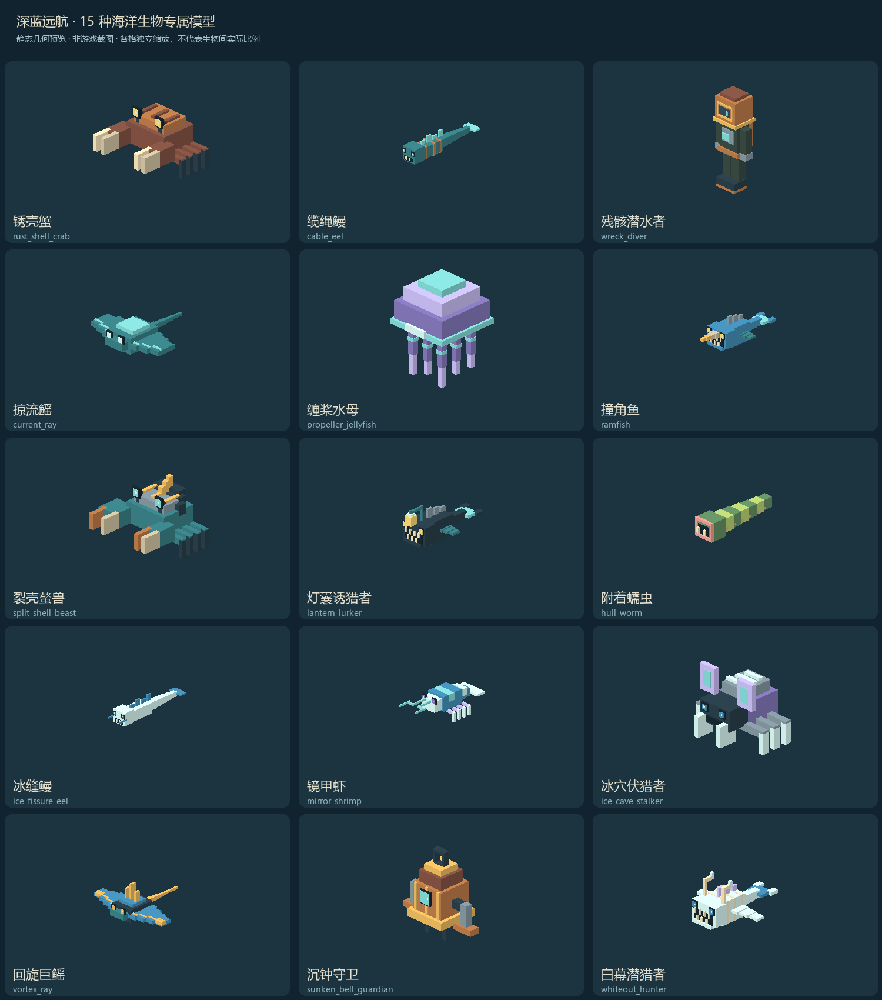

# 怪物模型目录

12种普通怪与3个Boss的专属模型。沿用原型AI，未实现草案专属技能；本次不启动游戏验收。

| 生物 | 几何文件 | 外观 |
| --- | --- | --- |
| 锈壳蟹 | `models/entity/rust_shell_crab.json` | 锈色扇形甲壳、八足、眼柄与可摆动双钳。 |
| 缆绳鳗 | `models/entity/cable_eel.json` | 蓝绿长鳗、铜色缆绳环节、细背鳍与五段尾部。 |
| 残骸潜水者 | `models/entity/wreck_diver.json` | 旧式铜盔潜水服、窥视窗、双背罐、软管、护手和配重靴。 |
| 掠流鳐 | `models/entity/current_ray.json` | 流线鳐身、分层宽翼、浅色翼缘与细鞭尾。 |
| 缠桨水母 | `models/entity/propeller_jellyfish.json` | 紫蓝阶梯伞盖、浅色伞缘和八组双节触须。 |
| 撞角鱼 | `models/entity/ramfish.json` | 蓝色重头鱼、前伸骨角、背棘、胸鳍和叉尾。 |
| 裂壳螯兽 | `models/entity/split_shell_beast.json` | 深色重叠甲片、外露金色关节和不对称重钳。 |
| 灯囊诱猎者 | `models/entity/lantern_lurker.json` | 深海灯笼鱼，宽口尖牙、独立下颌、弯曲灯须与明亮灯囊。 |
| 附着蠕虫 | `models/entity/hull_worm.json` | 绿色分节蠕虫，粉色吸附口和六段可摆动腹部。 |
| 冰缝鳗 | `models/entity/ice_fissure_eel.json` | 冰白细鳗，蓝色背鳍、前须和分节尾部。 |
| 镜甲虾 | `models/entity/mirror_shrimp.json` | 镜蓝叠甲虾、八足、两根长触角与扇形尾。 |
| 冰穴伏猎者 | `models/entity/ice_cave_stalker.json` | 六足伏猎者，低伏骨甲、展开的听觉膜和两只前爪。 |
| 回旋巨鳐 | `models/entity/vortex_ray.json` | 深蓝巨鳐，金色翼脉、冠状背鳍、加宽四节翼与长尾。 |
| 沉钟守卫 | `models/entity/sunken_bell_guardian.json` | 沉钟式铜质机械守卫，钟冠、青色观察眼、锚形臂和悬链。 |
| 白幕潜猎者 | `models/entity/whiteout_hunter.json` | 冰白骨甲猎手，分节肋甲、头部冰角、长刃胸鳍与獠牙。 |
