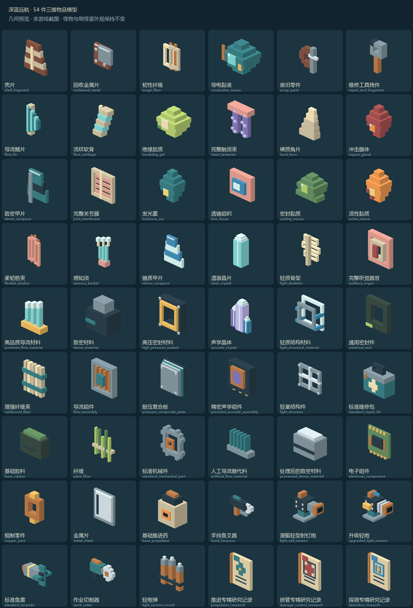

# 物品模型目录

54 个物品使用独立原生三维模型；这里是几何离线预览，未进行客户端验收。

| 物品 | 模型 ID | 结构说明 |
| --- | --- | --- |
| 壳片 | `dbv_world:item/prototypes/shell_fragment` | 不规则锈色扇形壳片，浅色断口与中央壳脊。 |
| 回收金属片 | `dbv_world:item/prototypes/reclaimed_metal` | 两片带铆钉的锈蚀回收铁片，错位叠放。 |
| 韧性纤维 | `dbv_world:item/prototypes/tough_fiber` | 米色粗纤维双束，铜色束带。 |
| 导电黏液 | `dbv_world:item/prototypes/conductive_mucus` | 蓝绿色黏液团，包裹铜质导电颗粒。 |
| 废旧零件 | `dbv_world:item/prototypes/scrap_parts` | 破旧齿轮、断轴与横销构成的零件组。 |
| 维修工具残件 | `dbv_world:item/prototypes/repair_tool_fragment` | 断裂扳手头与短柄，缺口用暗色金属表现。 |
| 导流鳍片 | `dbv_world:item/prototypes/flow_fin` | 向后收尖的水动力鳍片，浅色骨条支撑。 |
| 流纹软骨 | `dbv_world:item/prototypes/flow_cartilage` | 弧形分节软骨，蓝色软组织和浅色骨节。 |
| 绝缘胶质 | `dbv_world:item/prototypes/insulating_gel` | 浅黄绿色绝缘胶团，宽底和圆润阶梯轮廓。 |
| 完整触须束 | `dbv_world:item/prototypes/intact_tentacles` | 四根长短不同的紫色触须，带浅色吸盘与根部组织。 |
| 硬质角片 | `dbv_world:item/prototypes/hard_horn` | 弯曲收尖的硬质角片，厚根与明亮角尖。 |
| 冲击腺体 | `dbv_world:item/prototypes/impact_gland` | 红褐色冲击腺体，橙色中央腺泡与短颈。 |
| 致密甲片 | `dbv_world:item/prototypes/dense_carapace` | 三层深海厚甲片，背面中脊和深色重叠边缘。 |
| 完整关节膜 | `dbv_world:item/prototypes/joint_membrane` | 浅色关节骨框内的粉色褶皱膜片。 |
| 发光囊 | `dbv_world:item/prototypes/luminous_sac` | 带细蒂的发光囊，蓝绿外膜与黄色发光核心；仅明亮配色，不发动态光。 |
| 透镜组织 | `dbv_world:item/prototypes/lens_tissue` | 肉质边缘包裹的蓝色透镜组织，中心反光面。 |
| 密封黏质 | `dbv_world:item/prototypes/sealing_mucus` | 暗绿密封黏质，低矮胶团与扩散的黏液底缘。 |
| 活性黏质 | `dbv_world:item/prototypes/active_mucus` | 橙色活性胶团，红色囊泡和亮黄核心。 |
| 柔韧筋束 | `dbv_world:item/prototypes/flexible_tendon` | 三股细长粉色筋腱，回环和扎束结构。 |
| 感知须 | `dbv_world:item/prototypes/sensory_barbel` | 分叉感知须，柔软根部与三个发亮感知端点。 |
| 镜质甲片 | `dbv_world:item/prototypes/mirror_carapace` | 四层镜质甲片，冷色反光与蓝色夹层。 |
| 清澈晶片 | `dbv_world:item/prototypes/clear_crystal` | 单根清澈六棱感方晶，浅蓝主体与白色晶尖。 |
| 轻质骨架 | `dbv_world:item/prototypes/light_skeleton` | 镂空肋骨与细脊柱，强调轻质骨架。 |
| 完整听觉器官 | `dbv_world:item/prototypes/auditory_organ` | 耳蜗状双层环组织，中央红色听觉膜。 |
| 高品质导流材料 | `dbv_world:item/prototypes/premium_flow_material` | 金色基座中的三片优质导流晶鳍。 |
| 致密材料 | `dbv_world:item/prototypes/dense_material` | 厚重深色矿质块，阶梯断面与蓝绿矿脉。 |
| 高压密封材料 | `dbv_world:item/prototypes/high_pressure_sealant` | 加固高压密封环，金属压边与四角螺钉。 |
| 声学晶体 | `dbv_world:item/prototypes/acoustic_crystal` | 三支不同高度的声学晶簇，紫色晶体与浅色晶尖。 |
| 轻质结构材料 | `dbv_world:item/prototypes/light_structural_material` | 双层空心轻质框架，少量蓝色连接节点。 |
| 通用密封件 | `dbv_world:item/prototypes/universal_seal` | 方圆风格通用橡胶密封圈，带方向色标。 |
| 增强纤维束 | `dbv_world:item/prototypes/reinforced_fiber` | 五股直纤维加强束，两道工业绑带。 |
| 导流组件 | `dbv_world:item/prototypes/flow_assembly` | 金属方框中的铜制导流叶片与中央轴毂。 |
| 耐压复合板 | `dbv_world:item/prototypes/pressure_composite_plate` | 三层耐压复合板，金属面板、密封夹层和四角铆钉。 |
| 精密声学组件 | `dbv_world:item/prototypes/precision_acoustic_assembly` | 精密声学模块，铜环晶体传感头与底部接线端。 |
| 轻量结构件 | `dbv_world:item/prototypes/light_structure` | 十字支撑的镂空轻量金属框架。 |
| 标准维修包 | `dbv_world:item/prototypes/standard_repair_kit` | 蓝绿维修工具箱，提手、金属箱沿和浅色十字标识。 |
| 基础胶料 | `dbv_world:item/prototypes/base_rubber` | 未加工胶料砖，暗绿表面和一道压制纹。 |
| 纤维 | `dbv_world:item/prototypes/plant_fiber` | 松散植物纤维束，长短不一，浅色捆绳。 |
| 标准机械件 | `dbv_world:item/prototypes/standard_mechanical_part` | 完整标准齿轮，钢制轮齿与铜色轴套。 |
| 人工导流替代料 | `dbv_world:item/prototypes/artificial_flow_material` | 规则工业导流坯，五片整齐散热鳍。 |
| 处理后的致密材料 | `dbv_world:item/prototypes/processed_dense_material` | 处理后的致密金属坯，规整断面与加工刻线。 |
| 电子组件 | `dbv_world:item/prototypes/electronic_component` | 绿色电路板，深色集成芯片、铜走线和金色触点。 |
| 铜制零件 | `dbv_world:item/prototypes/copper_part` | 铜制法兰环，带两处连接凸耳。 |
| 金属片 | `dbv_world:item/prototypes/metal_sheet` | 两张银灰金属薄片，折边与切割刻线。 |
| 基础推进药 | `dbv_world:item/prototypes/base_propellant` | 封口推进药袋，橙色警示牌和扎紧袋口。 |
| 手持鱼叉器 | `dbv_world:item/prototypes/hand_harpoon` | 手持鱼叉器：滑轨、叉头、铜色握柄和护圈。 |
| 潜艇轻型射钉炮 | `dbv_world:item/prototypes/light_nail_cannon` | 潜艇轻型射钉炮：短粗炮管、底座、侧铆钉与上方供弹口。 |
| 升级轻炮 | `dbv_world:item/prototypes/upgraded_light_cannon` | 升级轻炮：加强炮口、散热箍、侧挂供弹盒与蓝色瞄具。 |
| 标准鱼雷 | `dbv_world:item/prototypes/standard_torpedo` | 标准鱼雷：铜色收尖战斗部、钢制筒身、黄色识别带和十字尾翼。 |
| 作业切割器 | `dbv_world:item/prototypes/work_cutter` | 作业切割器：蓝绿机壳、下握柄、铜管和前端锯齿切割轮。 |
| 轻炮弹 | `dbv_world:item/prototypes/light_cannon_round` | 三发轻炮钉弹，由深色弹夹固定，铜壳钢尖。 |
| 推进专精研究记录 | `dbv_world:item/prototypes/propulsion_research` | 推进研究记录：铜装订纸册，螺旋桨式推进图标。 |
| 损管专精研究记录 | `dbv_world:item/prototypes/damage_control_research` | 损管研究记录：铜装订纸册，红色维修十字与防护框。 |
| 探测专精研究记录 | `dbv_world:item/prototypes/detection_research` | 探测研究记录：铜装订纸册，蓝色声呐环与金色指针。 |
