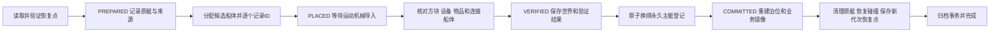

# 主艇完整恢复与 JSON 档案

日期：2026-11-05。适用环境：Minecraft 1.21.1、NeoForge，以及本工程锁定的 Sable、Create Aeronautics、Deep Seas、Create 和相关设备版本。

本文说明 v0.1.17 的数据结构、恢复流程和兼容边界。90 项 Java 测试及四阶段无界面服务端验收通过，见[本版验收报告](../../outputs/验收-v0.1.17-20261105/README.md)；未启动客户端进行 GUI 或双人界面测试。

## 已接入的功能

唯一主艇的永久 `vesselId` 保留，恢复时创建新的航空学物理船体并更新 `bodyId` 与 `generation`。中央控制器损毁、整艘船已消失或原艇远处未加载，都不需要重新登记另一艘“主艇”。岸上的信息面板和命令根据永久主艇档案工作。

完整恢复使用独立恢复点中的原生船体蓝图，覆盖船体方块、方块实体、已序列化设备状态与物品/流体等内容，并核对当前支持的连接子船体和运动机械。导入完成后还会做内容核对；上游导入回调完成本身不代表整艇恢复成功。

自研改装和泊位记录已经统一写入 JSON。Minecraft 方块实体及航空学 API 仍使用内存中的 `CompoundTag` 等类型，我们通过带类型 JSON 保存数值类型、数组和嵌套数据，再在适配边界还原给上游 API。新的自研船坞记录不再写二进制 NBT 文件；这不改变 Minecraft 和第三方 Mod 自身的世界存档格式。

## 玩家操作

1. 正常管理时，对酒壶控制台使用潜行键加右键，或右键艇内信息面板，进入管理界面。
2. 切换到“整艇档案”，点击“备份整艘潜艇”可以明确把当前设计、设备和存储作为新的恢复点。
3. 潜艇损毁后，回到初始船坞岸边，右键放在岸上的信息面板，进入“整艇档案”，点击“船坞整艇恢复”。此入口不依赖原艇控制器仍然存在。
4. 等待导入、核对、换绑和停泊完成。界面显示结果，永久主艇编号不变。

等价命令：

```text
/dbv flagship panel
/dbv flagship backup
/dbv flagship recover
```

`panel` 打开船坞档案，`backup` 保存当前整艇，`recover` 从恢复点重新部署整艇。恢复操作目前面向创造模式管理员，并在初始船坞范围内执行；手动备份沿用现有船坞/改装访问条件。普通生存玩家的费用、权限和任务流程不在本轮实现中。

“仅恢复容器物品”仍是独立的旧操作，只恢复位置、类型和槽数匹配的实际容器，不能替代“船坞整艇恢复”。恢复期间，改装、出航/停泊和修改舱内存储暂不并行执行，避免同一主艇同时被两项事务改写。

## 数据目录和权威来源

下列路径均相对当前世界目录，不相对 Git 仓库。`<vesselId>` 是永久主艇 UUID。

```text
dbv/fleet/
├─ registry.json
├─ registry.refit.pending.json                 # 换绑中断时可能存在
├─ vessels/<vesselId>/
│  ├─ state.json
│  ├─ recovery-checkpoint.json
│  ├─ recovery-transaction.json                # 整艇恢复期间存在
│  ├─ backups/<uuid>.json
│  ├─ automatic/<uuid>.json
│  ├─ recovery-history/
│  ├─ recovery-evidence/                       # 当前镜像损坏时保留原始字节
│  └─ storage-recovery.json                    # 仅容器恢复的旧事务标记
└─ dock/
   ├─ starter.json
   ├─ starter-request.json
   ├─ starter-building.json
   ├─ block-refit.json                         # 方块改装期间存在
   ├─ active-refit.json                        # 兼容旧改装事务
   ├─ history/
   └─ legacy-nbt/                             # 迁移后的旧原件，仅归档
```

| 档案 | 内容与职责 |
| --- | --- |
| `registry.json` | 永久身份、当前物理载体、名称、维度、代次，是主艇身份的权威来源 |
| `state.json` | 最近一次成功捕获的业务镜像；包含 `vessel`、`structure`、`storage`、`navigation`、`berth`、`refit` 等模块，并保留其他业务模块 |
| `structure` 模块 | 相对坐标的方块状态、设备元数据、原生完整船体蓝图；原生蓝图负责上游物理船体和运动结构的重建 |
| `storage` 模块 | 实际容器、槽位及物品组件的可读快照；游戏内实际容器仍是实时物品来源 |
| `berth` 模块与 `starter.json` | 恢复点内保存泊位业务镜像；运行泊位记录保存当前载体的锚点和姿态，恢复后重新生成与新载体匹配的记录 |
| `refit` 模块与 `block-refit.json` | 业务镜像记录改装状态；活动改装 JSON 保存完整事务阶段、原船方块/设备和业务备份引用，承担回滚职责 |
| `recovery-checkpoint.json` | 独立保留的整艇恢复点，包含完整业务快照、时间、校验值和损伤冻结标志；不参加 20 份自动历史的轮转 |
| `recovery-transaction.json` | 整艇恢复的持久化决策，保存来源快照、原载体、候选载体集合、阶段和核对结果 |
| `backups/` | 明确保存的备份，不因自动历史轮转而删除 |
| `automatic/` | 变更触发的自动历史，保留最近 20 份 |
| `recovery-history/` | 已完成/撤销恢复事务，以及恢复过程中归档的中断写入证据 |
| `recovery-evidence/` | 使用已验证恢复点接管损坏的当前镜像时，保留原 `state` 和相关未完成写入原件 |
| `dock/history/` | 已完成、取消或拒绝的改装记录，以及重建泊位时保留的中断记录 |
| `dock/legacy-nbt/` | 旧 NBT 的原始字节归档，不参与新的正常读写 |

船坞目录位于 `dbv/fleet/dock`，是唯一主艇共享的船坞服务记录；它还负责主艇尚未登记时的初始创建，因此没有强行移入某个尚不存在的艇 ID 目录。主艇快照中同时带泊位和改装业务信息，整艇恢复事务与恢复点放在相应 `vesselId` 目录下。

正常运行中不要把这些 JSON 当作实时虚拟仓库：修改 JSON 不会同步改写当前世界里的物品。完整世界回退仍应使用世界备份；只复制某个业务 JSON 不能替代原版区块、第三方实体及世界数据。

## 捕获、损伤冻结和恢复点更新

服务端通常每 100 tick 捕获一次主艇，即正常 20 TPS 时约 5 秒；服务器退出时也会捕获。活动改装或整艇恢复期间暂停普通周期捕获，使用对应事务保存其转换状态。

未发现结构损失时，恢复点随完整捕获更新，因此正常物品存取、设备资源变化和新增结构会进入后续恢复点。`recoveryTopology` 同时记录根船、连接子船和轴承活动结构中的方块。检测到已记录方块缺失、被另一类方块替换，或完整船体变为空/不完整时，保留此前完整图像并设置 `damageDetected`。冻结后，后续残骸快照和自动历史不会覆盖这份整艇恢复点；断电后的比较也以已发布恢复点为基线，不以已经损坏的当前镜像为基线。

当前损伤判定是结构对比，不区分“敌人破坏”和“玩家有意拆除”。完成主动设计变更后，可通过手动整艇备份明确接受新设计；成功提交改装也会建立新的完整恢复点。取消/失败回滚后，以已经还原的船体建立恢复点。

这仍是周期快照，不是每次伤害前的同步事务日志。最后一次成功捕获到受损之间的变化，可能不在冻结恢复点里。自动历史、独立恢复点和手动备份是不同用途的数据，不能把“最近自动记录”直接等同于“最后完整设计”。

## 分配、验证、换绑和清理



恢复会先查询原生磁盘索引。原艇远处未加载，不等于已经损毁；需要找到并加载其记录，才能在成功换绑后处理原载体，避免留下第二艘主艇。原主船体消失但快照中的连接子船仍存在时，也纳入旧载体核对与清理。

候选船体导入期间暂时关闭船体碰撞，防止尚未提交的新旧物理艇互相推挤；原艇退役后恢复各船体快照中的碰撞设置。连接子船依据导入时建立的来源映射匹配，不能只凭相同外形交换左右舱的设备和货物。

候选 ID 只从原生新分配方法的回执记录，重新加载旁边既有船体不会被当成候选。原生拆分发生时记录父子关系，失败回滚可清理候选的拆分后代。蓝图采用 `connected-only-v1`，不会按包围盒相交把旁边独立小艇混入主艇；缺少该范围标记的旧多体蓝图需重新备份后使用，单体旧档仍可读取。

| 中断位置 | 后续处理 |
| --- | --- |
| 首次事务仅写出完整 `.pending`，尚未发布 | 校验通过后发布；截断或损坏则保留证据并报告 |
| 事务替换写入中断，既有正式记录仍有效 | 保留最后正式阶段的决策，不把未发布替换当作已完成操作 |
| 新船分配或导入中断，永久登记仍指向原艇 | 根据持久化候选集合清理未提交船体，保留原艇和恢复点，可重新恢复 |
| 已验证，登记换绑留下 pending | 只有事务和新登记精确匹配时继续提交；截断/不匹配的新登记保留到历史，原登记不变 |
| 永久登记已经换绑，后续泊位/数据写入未完成 | 继续完成新载体的标签、泊位和业务状态，不能回退到已退役的旧载体 |
| 清理原艇后、事务归档前中断 | 根据已提交的新载体继续完成剩余清理和保存；不存在的旧载体不再创建 |

恢复失败不会以“部分导入成功”结束：内容核对未通过时保留来源档案，提交前清理候选；已经提交的操作保留事务并报告后续完成失败。不同艇 ID、未知数据版本、校验失败等情况不会静默建立新身份。

## 旧 NBT 迁移

打开旧世界时，会检查 `dock` 根目录与 `history` 下的旧 `.nbt`。正常迁移顺序是读取原件、生成带格式版本与 SHA-256 的 typed JSON、验证无损读回，然后把旧二进制原件移到 `legacy-nbt` 中相同相对路径。

迁移在 JSON 已发布、旧文件尚未归档时中断，下次会比较两份内容一致后继续归档；两份内容冲突或旧 `.nbt.pending` 存在时保留原文件并报告，不猜测哪份状态正确。历史 NBT 归档不是继续双写，也不是恢复时优先读取的另一套权威数据。

正常的新初始艇请求、泊位、方块改装、旧流程兼容事务以及后续历史记录均写 JSON。旧改装恢复代码仍保留，因为旧世界可能携带尚未结束的事务；不能直接删除兼容代码或迁移标记。

## 设备与内容支持边界

恢复依赖当前锁定版本的原生蓝图与本模组适配，而非仅根据设备名称宣称支持全部内容。核心核对包括：

- 船体及连接子船的方块数量和状态；仅对管道连接、储罐形状等明确会重新计算的派生状态作定向归一化。
- 方块实体的配置及持久化资源子树，包括物品组件、储罐中的柴油/水/氧气、已支持的能量字段；不把全局移除坐标、UUID 或资源字段当作“核对通过”。
- 当前版本已识别的 Create 储罐、储物库、红石链路，Deep Seas 压载控制器/氧气设备，柴油设备及航空学连接设备的坐标引用与运行缓存。
- 原生蓝图支持的运动结构及其中的物品；轴承等控制器与运动锚点需要匹配，新导入中的机器仍要等待原生延迟恢复完成。
- 缺失方块/物品/流体依赖或无法解析的物品组件，会在导入或核对阶段明确失败。

新增第三方设备时，必须核对其保存内容、位置链接和恢复后的实际行为。某设备把数据存到自己的全局文件、未被原生蓝图捕获的实体或外部网络中时，需要单独适配。玩家背包、岸上仓库、世界掉落物和独立生物不属于这份主艇快照。

恢复重新建立新载体编号、原生网络缓存、泊位和临时物理状态；它不是把原物理实体 UUID 原样复制到第二艘船上。潜艇正常运行后，燃料消耗、氧气生成和世界 tick 仍按原有设备行为继续。

本版还修复 Deep Seas 电解器读档时误用限速收发接口导致 FE 丢失的问题，按保存值精确反序列化。容量、能耗、生产和传输速率保持原有设置。电解器“正在生产”显示及速度计读数属于重新计算的运行测量，设备模块、启用状态、目标设置及资源内容仍严格核对。

## 代码入口与验收

| 入口 | 职责 |
| --- | --- |
| `fleet/persistence/VesselDataStore` | 业务镜像、恢复点、冻结和历史 |
| `fleet/persistence/RegistryStore` | 永久身份与登记换绑、验证过的 pending 恢复 |
| `fleet/dock/DockFiles`、`DockJsonCodec` | 船坞 JSON 编解码与旧 NBT 迁移 |
| `fleet/dock/RefitService`、`StarterSubmarine` | 改装状态机、泊位记录与恢复后停泊 |
| `fleet/recovery/RecoveryJournal` | 整艇恢复决策的持久化与历史 |
| `fleet/recovery/WholeVesselRecovery` | 导入、验证、换绑、清理的协调 |
| `fleet/recovery/NativeVesselArchive` | 原生蓝图、设备内容与子船匹配适配 |
| `fleet/ui/FleetPanel`、`fleet/client/FleetScreen` | 船载/岸上面板与一键操作 |

本轮新增单元回归覆盖 typed JSON 类型与迁移、恢复点冻结和轮转、事务阶段/pending、身份换绑及语言资源。正式服务器验收通过独立副本测试当前依赖、实际设备、损毁后重部署和重启继续；验收脚本会主动修改其测试世界，不应当作正式存档的只读检查。脚本为 `tools/test-whole-vessel-recovery.ps1`，探针及独立实例不会进入正常玩家客户端或正式服务器包。

实际结果与测试产物哈希见[四阶段验收报告](../../outputs/验收-v0.1.17-20261105/README.md)。它包含真实整艇恢复、重启、中断重试以及分裂失败清理；多人界面交互仍需后续联机验收。
