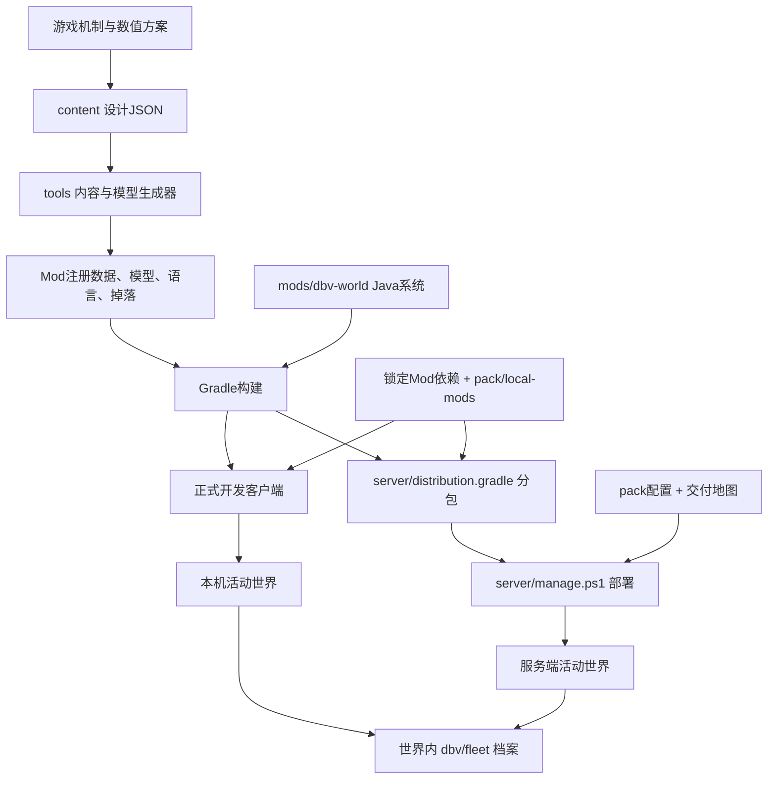

# 开发版本总览

审计日期：2026-11-05。根据当前源码、资源、脚本和本地目录建立；设计文档表达目标，源码表达当前实现，验收报告只证明当时的版本。

## 当前版本是什么

这是以海洋世界和唯一主潜艇为中心的**建设与系统联调原型**。当前源码版本0.1.17，对应develop分支与v0.1.17标签；地图交付仍是0.1.4。世界、Mod、便携工具与测试报告各有版本，不应混用编号。

- 运行环境：Minecraft1.21.1、NeoForge21.1.259、Java21、VS Code。
- 当前正式开发入口：根目录tools/dev.ps1；客户端在runtime/client；合作服务器由server/manage.ps1管理。
- config/development-session.json启用建设模式，渲染距离6、模拟距离5、30FPS。
- 游戏机制、数值方案及相关资料完整保留。实现状态必须通过下表与源码核对，不能根据“已写设计文档”判断功能上线。

## 系统与数据流

Git保存代码、规格、资源、配置与初始地图；runtime保存游玩后的真实世界。Git更新本身不替换玩家世界，也不会把本机进度同步给伙伴。

## 五个主要部分

| 部分 | 代码入口与职责 | 已有能力 | 当前边界 |
| --- | --- | --- | --- |
| 世界 | world/DeepBlueVoyageWorld、FloodedWorldGenerator、VoyageLayout、VoyageTerrain、MineralCatalog | 海洋高度、起始岛建筑/船坞、资源岛与矿种、原油、岛屿保护 | 地区有占位设计；不是完整群系怪物生态或科技锁地图 |
| 主艇 | fleet/FleetModule、compat/SableVesselAdapter、VesselInspection、dock/StarterSubmarine、RefitService、recovery/WholeVesselRecovery | 唯一身份、用户世界5设计艇、三条件检测、设备识别、实体↔方块改装、出航/停泊；独立JSON档案、损伤冻结及船坞整艇恢复 | 当前管理操作主要面向创造管理员；生存成本/权限流程未完成；恢复依赖完整恢复点和当前设备适配，见本版验收记录 |
| 设备与交互 | fleet/ui/FleetPanel、StorageTerminalMenu，fleet/client界面，fleet/door | 中文控制面板、实际容器交互、舱内/岸上面板、整艇档案按钮、人员门与自由形大门 | 舱门双面玻璃、LOD画面和多人体验仍需分别验收；气密检查为提示，不强制气闸 |
| 内容 | content/PrototypeContent、content/client、dbv_prototypes.json | 54项物品、15种海洋怪物/刷怪蛋、自研模型、掉落定义 | 54项物品都是普通Item原型，没有专属武器/维修等功能；15种怪物无自然生成，沿用原版基础AI，未完成专属技能、Boss阶段和船体战斗 |
| 工具与交付 | tools设计器/生成器、server/manage.ps1、pack | JSON规格设计、便携发行、地图导入、双端分包、联机更新备份 | 便携包是源码生成物，不能两边分别维护；导出包不是服务器游玩存档 |

酒狐AI目前只有规划与包占位，尚无完整驾驶、托管战斗和协作任务系统。洋流速度锁、深度压力锁、体积准入、各海域材料掉落与升级数值仍需逐项从方案落实，不应当作已完成系统。

## 主艇的身份、物理与改装

1. Sable/Create Aeronautics承载物理船体；自研系统给它登记稳定主艇身份，并记录当前物理载体的ID。
2. Deep Seas提供潜艇设备、气密和氧气能力。酒壶控制台扩展其控制器；资格检查对应中央控制器、氧气制造/供给、密闭空间。
3. 开始改装保存事务和结构，再把物理艇拆为船坞世界方块；改装期间主艇身份保留。
4. 提交改装先临时装配并等待检测，通过后交付；失败或取消走恢复路径。改装过程中重启时，完整STATIC阶段会自动回滚未完成的施工；半转换阶段锁定并保留档案，不猜测恢复。
5. 出航/停泊涉及岸供、约束和物理状态；重量、推进与升潜主体仍由上游Mod负责。之前全局升力/速度调参已撤回，不能使用旧海试数据当作当前参数。
6. 损毁恢复使用独立整艇恢复点，在船坞导入新的原生船体，核对结构、设备和物品后原子换绑永久身份，再清理原载体并重建泊位。岸上信息面板与`/dbv flagship recover`不依赖原控制器仍然存在。

仍保留以控制器位置作为深度基准的Mixin；真实水面未知时，控制器会让泵进入HOLD并暂停自动升潜。因此“浮力算法来自原生Mod”不等于本模组完全没有修改上游控制行为。

FleetModule在服务端每20tick采样船况，通常每100tick且非改装/整艇恢复中捕获舱内存储与结构。结构损失会冻结此前完整恢复点；当前拓扑记录同时覆盖连接子船及运动结构的方块，避免主船壳未变时丢失子船仍覆盖恢复点。手动整艇备份、成功改装及完成回滚后明确更新恢复点。这是周期快照，不是每个改动的即时事务日志，最后一次成功捕获后的变化仍可能丢失。

## 独立JSON档案与完整恢复边界

| 数据 | 当前权威来源/位置 | 不能误解为 |
| --- | --- | --- |
| 主艇身份 | 世界目录dbv/fleet/registry.json，RegistryStore原子写入 | 一个仅靠实体临时标签维持的身份 |
| 船内实际物品/方块 | 世界/Sable船体中的实体容器和方块 | JSON虚拟仓库直接替代实际容器 |
| 舱内存储/结构外部快照 | CabinStorage与BlockEntityJson将可序列化状态及原生船体蓝图写入独立JSON；新结构标记`captureScope=connected-only-v1` | 旁边相交但无真实连接的其他船也属于主艇；任意第三方设备都已支持 |
| 整艇恢复点 | `vessels/<id>/recovery-checkpoint.json`，独立保留完整图像、校验值和损伤冻结状态 | 自动历史中的最新残骸快照；每次损坏前必达的同步日志 |
| 整艇恢复事务 | `vessels/<id>/recovery-transaction.json`，记录分配、验证、换绑与清理；结束后进入`recovery-history` | 只导入一个蓝图就已经恢复成功 |
| 改装事务和泊位 | `dbv/fleet/dock/block-refit.json`、`active-refit.json`、`starter.json`等版本化JSON；主艇业务镜像带`refit`和`berth`模块 | 直接把旧文件后缀改为JSON；替换Minecraft/航空学原生世界存储格式 |
| 旧恢复和迁移 | 旧NBT校验迁移后归档至`dock/legacy-nbt`；LegacyRefitService兼容尚未结束的旧事务 | 可以按重复或Legacy名称直接删除旧恢复代码与迁移证据 |

存储终端当前提供54槽分页，直接操作船内实际容器；尚无AE式物品聚合、搜索或自动合成。界面把“仅恢复容器物品”和“船坞整艇恢复”区分：前者要求现有容器布局匹配，后者从完整恢复点重建船体、当前支持的设备和存储物品，并保留永久主艇编号。

恢复通过原生蓝图重建当前支持的连接船体及运动机械，显式核对方块、设备状态、资源和链接。远处未加载的原艇会查询其原生磁盘索引，不当作已损毁；只有验证后才换绑并处理旧载体。旧多船体快照如果没有明确的连接范围标记，不能据此猜测旁边船只的归属，应在更新后对完整主艇重新备份，原档案保留。

自研新增持久化文件使用JSON，适配层仍使用上游的内存NBT对象；第三方模组自己的全局文件、世界掉落物和独立生物不自动成为主艇档案。后续工作是扩展设备适配、验证大型艇性能和补生存操作流程。具体目录、恢复步骤和断点处理见[主艇完整恢复与JSON档案](主艇完整恢复与JSON档案-whole-vessel-recovery-and-json.md)。本版90项Java测试和四阶段无界面服务端验收通过，实际结果与范围见[验收报告](../../outputs/验收-v0.1.17-20261105/README.md)。

## 文件来源与修改顺序

- **内容数值和规格**：编辑content中的完整设计JSON；由tools/content-designer生成注册数据。更改生成物前确认对应规格，否则再次生成可能覆盖。
- **视觉资源**：tools/item-models、creature-models、cabin-models维护可编辑几何，输出src/main/resources及docs/art预览。图片资源与几何JSON都要保留；默认16×16不等于模型只能有16个几何单位。
- **控制与持久化**：编辑Java，检查对应测试与已有存档恢复；不要用资源JSON代替服务端权限和事务逻辑。
- **Mod依赖**：build.gradle为实际加载列表，docs/current-mod-list.json包含更广的候选/批准状态；“批准”不等于已加载。两项用户原件由pack/local-mods固定文件和哈希。
- **工具**：tools是源码，tool是便携输出。更新工具后通过打包脚本刷新发行，避免维护两份分叉实现。
- **地图**：pack/worlds/world-manifest.json管理交付；runtime中的玩家进度独立保留。历史探针报告、旧艇模板与当前交付不能互相替代。

当前默认LOD组合为Voxy/Roxy/Sodium，动态光源按用户选择暂缓；两个服务器LOD扩展已接入但未实机验证双重处理与Roxy联动，详见[接入说明](远景与动态光源接入-lod-and-dynamic-lights.md)。

## 审计发现的待办

| 问题 | 当前结论 | 本轮处理 |
| --- | --- | --- |
| 根README与启动文档落后多个版本 | 0.1.4/0.1.0、main分支和不同地图说明混杂 | 已收敛成当前入口，并区分代码/地图版本 |
| 设计器默认材质回退64 | 只改示例不能解决再次生成覆盖 | 修正源码默认值，测试后重打便携包 |
| 壳方块采集属性 | HullBlocks复制黑曜石属性，needs_diamond_tool标签与用户“像铁块采集”要求有差异 | 记录待修，未擅自改变玩法 |
| 独立JSON与整艇恢复 | 0.1.17接入改装/泊位JSON、旧NBT迁移、独立恢复点、损伤冻结和船坞重部署 | 设备/物品与断点验证结果见本版验收记录；保留旧事务兼容 |
| 老验收探针 | FreshWorldProbe的旧矿种名单/排斥原矿与现在自动矿种规则不一致 | 作为历史工具识别，不拿旧结果证明当前生成 |
| 当前验收边界 | 历史实机证据不能证明0.1.17；整艇恢复与门/LOD/多人画面属于不同检查范围 | 整艇恢复结果见本版验收记录，未覆盖项目继续明确标注 |

## 文件审查范围

手写源码、测试、脚本和文档按文件审读；结构化资源按数据字段和生成器核对；JAR/地图/图像/ZIP按来源、内部清单与对应元数据识别。第三方依赖缓存和Git对象按来源/用途盘点，没有把逐文件登记说成对每个第三方二进制的源代码审计。

逐文件职责见同目录repository-files.json；完整本机物理文件盘点、整理前快照和归档校验记录保留在.local/repository-audit。历史证据入口见[outputs说明](../../outputs/README.md)。
