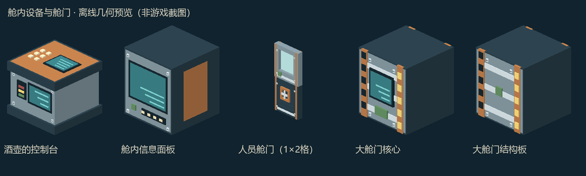

# 舱内设备与模块化舱门

2026-10-22 / 0.1.15修复说明：物理艇的门体连接扫描和隔离检测改读Sable船体区块，不再用普通世界的`hasChunkAt`检查船体存储坐标。船体范围外按外部空间处理；范围内确有区块缺失仍拒绝操作。编译通过，尚未实机复测。

开发版本：0.1.16；Minecraft 1.21.1 NeoForge。按用户要求不启动客户端或服务器，本文件区分代码实现与待实机验收内容。

## 模型和物品

| 名称 | ID | 外观与作用 |
| --- | --- | --- |
| 酒壶的控制台 | `dbv_world:jiuhu_console` | 金属台座、铜边、仪表屏、信号灯与按键；继续继承Deep Seas中央控制及既有管理界面 |
| 舱内信息面板 | `dbv_world:cabin_panel` | 金属屏幕柜；放置时朝向玩家，点击沿用主艇信息/存储终端 |
| 人员密闭舱门 | `dbv_world:personnel_hatch` | 1格宽、2格高，观察窗、手轮和锁定指示；沿用双格门铰链开闭 |
| 潜艇大舱门核心 | `dbv_world:hangar_door_core` | 带控制屏的门体核心；一个核心控制一组相连结构 |
| 潜艇大舱门结构板 | `dbv_world:hangar_door_panel` | 带加强筋、螺栓和警示条的拼装门板 |

均有物品模型、中英文名称、方块掉落，进入“深蓝远航”创造分类。新物品暂不增加未经确认的生存配方。五份可导入设计器的完整规格位于 `content/cabin-equipment/`；不混入普通物品/怪物原型生成目录。

## 大舱门搭建

放置一个核心，将结构板通过六面相邻连接，轮廓不限。各板朝向可不同，整组状态以核心为准，新接入结构板也会随整组操作。零核心、多核心属于结构无法识别；不再增加4096块限制、同向限制或开闭状态一致的操作前置条件。

开启时门板收起到视觉边缘，碰撞为空，位置和状态仍保留，方便关闭及备份。当前没有滑轨动画。

## 操作和气密

1. 空手右键开关；关闭后尚未气密。门口存在实体也可以关闭。
2. 空手潜行右键上锁/解锁。只有关闭并上锁，门才作为密封边界；已上锁的门须先解锁再开。
3. 开门前显示相邻舱室气密检查结果。数据更新中、没有物理艇舱室数据、未密闭，都只提示，不阻止操作。

人员门解锁后恢复原版红石开关；上锁时红石不能绕过锁。

移除未经用户要求的主控舱保护、强制独立气闸、干燥空间要求、实体占用和气密扫描预算拦截。仍保留Minecraft基本交互权限，以及识别门结构所必需的数据读取；人员门两半缺失、门结构所在区块确实不可读取时不能完成整组修改。

气密兼容接入Deep Seas `CompartmentDetector.isPermeable`：未锁定或已开启均可透气。没有修改上游物理、耐压、进水算法，也没有新增自动排水或压差控制。

## 外观与纹理

人员门两面采用相同装饰，上半部实际留出窗口并使用原版16×16透明玻璃，取消遮住窗户的实心背板。大型舱门闭合时前后均有加强筋、螺栓和指示灯，核心两面都有屏幕。开闭旋转沿用原版铁门状态映射。

物品与舱内设备共用16×16色板；怪物使用16×16色板，其几何JSON的1024×512是旧UV归一化坐标尺度，并非纹理图片尺寸。

## 保存、兼容与验收边界

新门没有额外BlockEntity仓库，朝向、铰链、上下半部、开闭和锁定保存在普通BlockState，走现有船体独立快照的方块状态路径；本次没有新增分散的业务NBT档案。正式船体上的备份恢复、物理化前后开闭与多人并发仍待实机验收。

显示器保持原ID与完整方块碰撞，新增朝向属性；旧存档缺少该属性时采用默认朝北，界面功能与容器数据路径不变。控制台继续使用上游BlockEntity，不更换主艇身份。新门与显示器也可在中央设备清单中识别。

静态验收包含Java编译、模型引用、门状态覆盖、双格门仅下半掉落、双语键及规格格式检查。未启动游戏，不能把这些检查等同于已验证潜艇密闭、真实通行、渐进进水或恢复。
