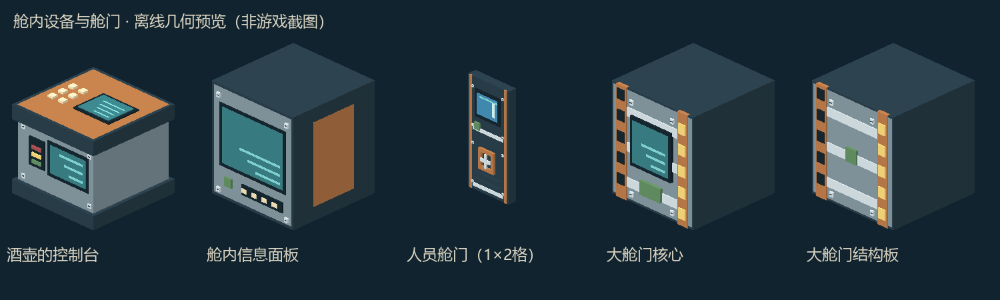

# 舱内设备与模块化舱门

2026-10-22 / 0.1.15修复说明：物理艇的门体连接扫描和隔离检测改读Sable船体区块，不再用普通世界的`hasChunkAt`检查船体存储坐标。船体范围外按外部空间处理；范围内确有区块缺失仍拒绝操作。编译通过，尚未实机复测。

开发版本：0.1.14；Minecraft 1.21.1 NeoForge。按用户要求不启动客户端或服务器，本文件区分代码实现与待实机验收内容。

## 模型和物品

| 名称 | ID | 外观与作用 |
| --- | --- | --- |
| 酒壶的控制台 | `dbv_world:jiuhu_console` | 金属台座、铜边、仪表屏、信号灯与按键；继续继承Deep Seas中央控制及既有管理界面 |
| 舱内信息面板 | `dbv_world:cabin_panel` | 金属屏幕柜；放置时朝向玩家，点击沿用主艇信息/存储终端 |
| 人员密闭舱门 | `dbv_world:personnel_hatch` | 1格宽、2格高，观察窗、手轮和锁定指示；沿用双格门铰链开闭 |
| 潜艇大舱门核心 | `dbv_world:hangar_door_core` | 带控制屏的门体核心；一个核心控制一组相连结构 |
| 潜艇大舱门结构板 | `dbv_world:hangar_door_panel` | 带加强筋、螺栓和警示条的拼装门板 |

均有物品模型、中英文名称、方块掉落，进入“深蓝远航”创造分类。新物品暂不增加未经确认的生存配方。五份可导入设计器的完整规格位于 `content/cabin-equipment/`；不混入普通物品/怪物原型生成目录。

## 大舱门搭建

放置一个核心，将结构板通过六面相邻连接，全部朝向保持一致。轮廓不固定，可拼矩形、阶梯形或其他连接形状，不按固定宽高注册多个门。相邻的独立门组要用普通结构隔开；零核心、多核心、方向混乱或开闭状态不一致会拒绝操作。

第一版整组上限4096块是工程保护预算，不是小潜艇的尺寸限制。开启时门板收起到视觉边缘，碰撞为空，方块位置和状态仍保留，方便关闭及现有结构快照记录；不是将方块删除后重新生成。不包含机械滑轨/伸缩动画，不提供“开启后可在原位置重新放方块”的空位。

## 操作和气密

空手操作，避免与工具交互混用：

1. 空手右键：关闭已开的门；关闭后仍未上锁。
2. 空手潜行右键：上锁；只有关闭且锁定才作为密封边界。
3. 再次空手潜行右键：先检查隔离，安全才解锁。解锁即不气密，不能依赖关闭但未锁的门保住氧气。
4. 解锁后空手右键：再次检查隔离，安全才开启。两次检查之间结构发生变化也要重新判断。

不接入红石自动开门，防止绕过隔离和锁定。上锁是密封锁定，不是玩家身份/密码锁。关闭前检查门口实体；物理艇上实体与局部坐标的实际交互仍待验收。

气密兼容通过Deep Seas `CompartmentDetector.isPermeable` 判定接入，仅针对本项目的新舱门：`未锁定或已开启 => 可透气`。不改变其他模组门的原规则，也不修改原生物理、耐压和渐进进水算法。上游舱室缓存异步更新期间可能暂时显示检测中。

开门的首版安全策略：

- 两侧及所有受影响邻接空间均为封闭干燥空间时，允许内部通行。
- 向外部/水体开启时，要求潜艇内另有独立、未破损、含中央控制器的气密主舱；本次开口不能与该主舱连通。
- 因此应采用内外两道门的气闸：先锁内门，确认主舱独立，再解锁外门。直接通向主控舱的外门拒绝开启。
- 区块未加载、舱室缓存脏或过期、检测超预算时拒绝操作，不把扫描截断当成气密。局部扫描预算32768节点，参考点周围64格之外不能认定封闭，较大舱室可能需要后续分帧检测。

这不是完整气闸自动化：尚无自动注排水、氧气置换、压差平衡或自动人员/子艇进出序列。湿舱与干舱之间不会因为“关上门”就自动排水。生存耐深沿用当前上游材料规则，未赋予新的耐压等级。

## 保存、兼容与验收边界

新门没有额外BlockEntity仓库，朝向、铰链、上下半部、开闭和锁定保存在普通BlockState，走现有船体独立快照的方块状态路径；本次没有新增分散的业务NBT档案。正式船体上的备份恢复、物理化前后开闭与多人并发仍待实机验收。

显示器保持原ID与完整方块碰撞，新增朝向属性；旧存档缺少该属性时采用默认朝北，界面功能与容器数据路径不变。控制台继续使用上游BlockEntity，不更换主艇身份。新门与显示器也可在中央设备清单中识别。

静态验收包含Java编译、模型引用、门状态覆盖、双格门仅下半掉落、双语键及规格格式检查。未启动游戏，不能把这些检查等同于已验证潜艇密闭、真实通行、渐进进水或恢复。
