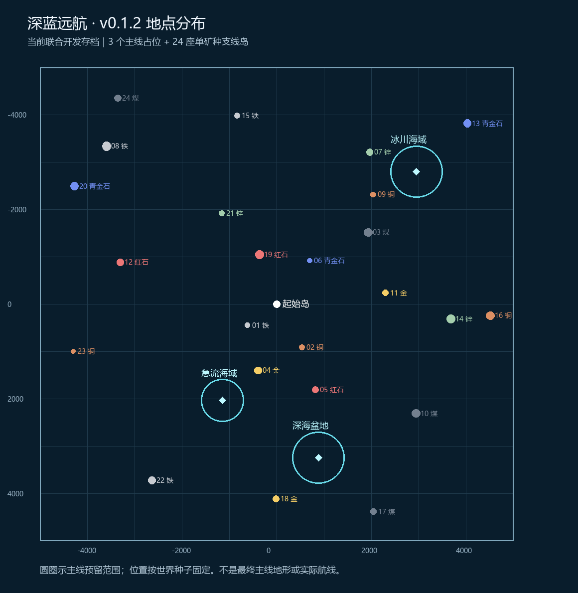

# 随机主线地点与矿脉支线岛（v0.1.2）

适用 Minecraft 1.21.1 / NeoForge，开发版本 0.1.2。当前仍使用海面 Y=128、最低 Y=-256、中心边长 10000 格的临时开发范围。

## 本次实现

用户要求随机生成支线岛及全部主线位置；未制作的主线内容用钻石块标记填充。支线岛正常生成，每岛只有一种高密度矿脉，可混入对应粗矿块。随后补充要求：现有 Mod 的矿石也要纳入，完成后提交 Git 并清除旧存档。

本次采用 **3 个主线地点、24 座支线岛** 作为可调整的开发默认布局。24 座及下列精确尺寸来自旧提案的落地选择，不追溯为用户已经确认的 1.0 数值。原提案、旧设定继续保留。随机是按世界种子生成固定位置，不是定时刷新或重置玩家建筑。

| 地点 | 默认布点 / 地形 | 当前内容 |
| --- | --- | --- |
| 急流海域 | 距起始中心 2200～2600 格；预留半径 450 格 | 钻石占位核心底部 Y=100 |
| 深海盆地 | 距起始中心 3000～3400 格；预留半径 550 格 | 钻石占位核心底部 Y=-160 |
| 冰川海域 | 距起始中心 3800～4200 格；预留半径 550 格 | 钻石占位核心底部 Y=136 |
| 补给岛 | 10 座；位置随机 | 岛屿、植被及矿脉；尚无补给设施 |
| 工业岛 | 8 座；位置随机 | 岛屿、植被及矿脉；尚无工厂或任务 |
| 挑战岛 | 6 座；位置随机 | 岛屿、植被及矿脉；尚无挑战或 Boss |

距离是中心直线距离，不能保证存在同长度的可通行航线；4 格/秒仍是设计目标，未调整或重测潜艇航速。主线主题范围采用预留尺度，**本次没有实现洋流、深海盆地或冰川的最终地形和关卡**。

每个主线地点有半径 24 格、高 8 格的实心钻石块核心，中心另放海面标记；四个方向的预留边界各放一组钻石块标记。没有把直径上千格、从海面到海床的整个区域填满。钻石是可开采的开发占位块，公开版本发布前必须替换，不能当作正式资源平衡。

## 支线岛与矿脉

- 岛屿基本半径 48～96 格；海岸受多频扰动影响，岸外增加至约 1.5 倍半径的海床过渡带，保留沙滩、起伏草坡、小树和草地。
- 每岛一条连续、不规则椭球矿脉，中心约 Y=112，主体藏于岛内。矿脉内部采用密集矿块，而非零散点矿。
- 24 岛分配铁、铜、煤、金、红石、青金石及机械动力的锌七种矿种：铁、铜、煤各 4 岛，其余各 3 岛。每座岛只有一个指定矿种。
- 铁、铜、金、锌矿脉中约七分之一方块使用对应粗矿块，其余为同种矿石；煤、红石、青金石只用矿石。不加入未经同意的新 Mod 或新矿物。
- 单矿种约束覆盖新造岛体（Y≥72）及其矿脉。更深的原始世界地层仍按正常世界生成，可存在原版其他矿石；这不属于新造岛体的专属矿脉。
- 岛屿上没有现成房屋、商人、任务或战斗设施。三种支线类型目前用于布点和后续建设分组，不代表对应玩法已经完成。

## 布点、生成与安全边界

世界种子决定位置，重新加载不重抽；不同种子得到不同布局。完整占地在 10000 格正方形内，避开起始岛和船坞。独立地点之间至少留 400 格过渡带，并检查中心间距；前三类主线之间至少相距 1600 格。部分支线优先靠近出航线路，不满足间距时改在其他海域选点；不保证每条直线航路均匀遇岛。

新世界随区块生成获得这些内容，不预生成整个正方形。当前联合开发存档在备份后单独生成全部支线岛及主线标记所需区块；游戏生成器会同时准备少量相邻区块。其余海域继续按探索生成。

本次升级只在副本上运行。预检任何目标区块若与已探索的完整区块重叠就停止，避免直接覆盖玩家建设；不是在每次进入世界时执行的自动覆盖脚本。测试脚本和临时 Java 验收辅助类不进入正式 Mod。

## 使用与后续编辑

更新源码并重新构建，再完整重启客户端。已有开发进度以本机“深蓝远航·联合开发”为准；协作者可使用 `pack/worlds/` 中四卷 ZIP 交付快照，通过 `tools/restore-world.ps1` 自动校验导入，禁止覆盖合并自己的存档。

下方坐标清单用于建设与定位，不代表永久固定坐标。若后续修改布点算法、数量或尺寸，必须另做存档迁移；不要直接让新老区块使用不一致的布局。

## 本次存档坐标与验收

世界种子：`7667568505341616740`。主线海面标记统一位于 Y=128 附近；支线矿脉中心约 Y=112。

| 地点 | X | Z | 核心 Y / 矿种 | 矿石与粗矿总量 |
| --- | ---: | ---: | --- | ---: |
| 急流海域 | -1141 | 2038 | 100 | — |
| 深海盆地 | 886 | 3249 | -160 | — |
| 冰川海域 | 2956 | -2797 | 136 | — |
| 支线01 · 补给岛 | -615 | 449 | 铁 | 26705 |
| 支线02 · 补给岛 | 536 | 914 | 铜 | 27805 |
| 支线03 · 补给岛 | 1941 | -1511 | 煤 | 70643 |
| 支线04 · 补给岛 | -390 | 1405 | 金 | 51449 |
| 支线05 · 补给岛 | 824 | 1813 | 红石 | 42786 |
| 支线06 · 补给岛 | 698 | -914 | 青金石 | 21973 |
| 支线07 · 补给岛 | 1970 | -3208 | 锌 | 46314 |
| 支线08 · 补给岛 | -3591 | -3334 | 铁 | 76085 |
| 支线09 · 补给岛 | 2038 | -2311 | 铜 | 28762 |
| 支线10 · 补给岛 | 2949 | 2313 | 煤 | 66024 |
| 支线11 · 工业岛 | 2301 | -236 | 金 | 34458 |
| 支线12 · 工业岛 | -3301 | -879 | 红石 | 51426 |
| 支线13 · 工业岛 | 4030 | -3813 | 青金石 | 60071 |
| 支线14 · 工业岛 | 3680 | 315 | 锌 | 71085 |
| 支线15 · 工业岛 | -829 | -3974 | 铁 | 30277 |
| 支线16 · 工业岛 | 4517 | 247 | 铜 | 69613 |
| 支线17 · 工业岛 | 2050 | 4387 | 煤 | 34380 |
| 支线18 · 工业岛 | -10 | 4116 | 金 | 40185 |
| 支线19 · 挑战岛 | -359 | -1041 | 红石 | 76800 |
| 支线20 · 挑战岛 | -4264 | -2486 | 青金石 | 63153 |
| 支线21 · 挑战岛 | -1163 | -1911 | 锌 | 30039 |
| 支线22 · 挑战岛 | -2635 | 3725 | 铁 | 57241 |
| 支线23 · 挑战岛 | -4294 | 1001 | 铜 | 23238 |
| 支线24 · 挑战岛 | -3353 | -4348 | 煤 | 42857 |

Mod 注册表核对：`create:zinc_ore`, `create:deepslate_zinc_ore`；两种锌矿方块属于同一种矿种，浅层岛体使用普通锌矿和粗锌块。

首次运行实际生成目标区块 4216 个；逐块检查每座岛的矿脉覆盖与单矿种约束，存盘后再次读取区块文件核对。单元测试 38 项通过，其中包含 1000 个种子的布局边界与间距检查。验收证据见 [outputs/islands-v0.1.2](../../outputs/islands-v0.1.2)。

保存后重进验证通过：27 个地点、潜艇唯一性与资格、停泊状态均正常；出口缓坡相邻落差最大 1 格。专门挖去一个矿块后重进，确认不会自动补矿，验收后已还原该方块。三个主线实心钻石核心各有 14344 个方块。

## 独立新建世界验证

按用户补充要求，额外使用种子 `1357924680`，通过游戏的“新建世界”流程从空目录创建 `深蓝远航 起始岛` 预设世界。没有复制任何已有 level.dat、区块或舰队数据，也没有对新地图做一次性地形修补。

- 正式 FloodedWorldGenerator 自动生成全部 27 个随机地点；该种子的 27 个地点坐标均不同于交付地图。
- 实际加载并检查 303 个目标区块，覆盖三个主线核心、边界标记、24 岛中心和岸线邻块；矿脉覆盖与单矿种检查通过，包含机械动力锌。
- 起始岛建设审计通过；保存退出后重新载入，27 个地点位置和标记保持一致，海面 128、最低 -256、边界 10000 均正确。
- 第一次重进按正常流程确认 Minecraft 的自定义生成预设提示；没有改动地形来通过测试。
- 新世界验收副本随后清理，仅保存验收结果与可重复执行的[测试夹具](../../mods/dbv-world/src/test/resources/acceptance/fresh-world/验收说明.md)。

这是一个独立新种子的实际生成与重进验证，加上 1000 个种子的布局单元测试；不声称已穷举所有种子。新建时必须选择“深蓝远航 起始岛”预设。交付地图专用的一次性操作仅用于提前加载地点，生成规则本身已在正式 Mod 内。

## 交付及清理

最新交付压缩包为 156281743 字节，分成四卷并附 SHA-256 清单。`tools/restore-world.ps1` 已完成实际合并导入验证，并验证重复导入会拒绝覆盖。正式 Mod 构建不包含验收辅助类。

本机只保留当前“深蓝远航·联合开发”游戏存档；旧活动副本和本轮临时世界清理，迁移前完整回退 ZIP 保留在 runtime 下。仓库只保留当前四卷快照；四个旧历史交付及旧单卷联合开发 ZIP 已移除，可从 v0.1.1 Git 历史恢复。
