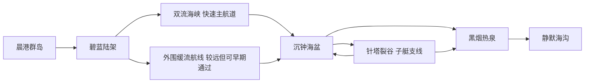

# 深蓝远航初版地图与科技路线

设计版本：0.1 草案。目标平台：Minecraft 1.21.1 NeoForge。核心体验是驾驶自己建造的潜艇远航，在海域限制中选择航线、改装设备，带着子艇和艇载助手完成探索与战斗。

本版承接[海域准入规则](ocean-access-gates.md)、[艇载 AI 与协同战斗](onboard-ai-and-cooperative-combat.md)及[当前 Mod 清单](../current-mod-list.md)。下文的区域、材料名、Boss 和配方均为设计提案；不会据此把待定或备选 Mod 转为确定加入。数值用于制作测试地图，不是现有模组的能力承诺。

## 一次远航应该发生什么

玩家在港口收到异常信号，检查本艇潜深、流速应对能力和返航物资，选择直达急流航道或较远的缓流航线。抵达海底设施后，母艇停在外部水域，子艇进入裂隙，玩家再离艇打开设施。回程带回矿样、设备和海图，解锁新的制造工艺，并决定下一次升级推进、耐压还是船内设备。

科技升级的主要奖励是新的行动方式：能逆流、能潜得更深、能让船在离艇时保护玩家、能在远海生活。大型潜艇增加设备和后勤容量，但仍需小艇完成狭窄空间的任务。

### 前几个小时的节奏目标

| 阶段 | 玩家体验目标 | 必须得到的反馈 |
| --- | --- | --- |
| 开局前 30 分钟 | 建立岸边补给点，潜入第一处浅水残骸 | 海底有值得探索的内容；任务指向可见目标 |
| 约 1～2 小时 | 完成第一艘密封小潜艇并安全返回 | 自己造的艇能够装货、下潜和补给 |
| 约 2～4 小时 | 在急流、窄洞和深水中分别遇到一次能力边界 | 能看懂问题，并知道升级、换艇或绕行的方法 |
| 首次完整远征 | 出航、离艇、战斗或作业、带回关键资源 | 一次有目标的远征约 20～40 分钟，含航行与探索 |

以上为试玩体验目标，不用倒计时或游戏天数强制解锁。熟练玩家可以提前推进，喜欢建造的玩家可以长期停留在任一阶段。

## 地图整体特点

采用“少量群岛 + 连通海盆 + 多条海沟 + 局部地下遗迹”的海洋世界。出生地是有基础资源的小型群岛，外部海面逐渐减少陆地，海底仍有明显的山脊、台地和地标。海洋提供航行空间，也通过地形和海流帮助玩家辨认方向。

| 项目 | 初版设计目标 | 落地边界 |
| --- | --- | --- |
| 海陆比例 | 首轮样板区约 85%～92% 的水平面积为海面 | 在样板区统计，不用单个出生点代替整体结果 |
| 样板区范围 | 先验证约 6,000 × 6,000 格的一组海域 | 不是最终世界边界；通过后再扩展种子与生成范围 |
| 区域分布 | 海域相互连接、有支路、有回环，不做严格同心圆 | 危险由地形与环境表达，不按离出生点距离直接伤害玩家 |
| 航道 | 母艇有连续宽水道；旁侧保留裂隙、洞穴与废墟 | 不能所有路线都被狭窄洞口截断 |
| 陆地 | 出生群岛、少数补给岛、废弃港口 | 木材、食物和基础金属不依赖找到遥远大陆 |
| 目标密度 | 有效航线上约每 300～600 格出现可识别线索 | 线索可为地标、资源迹象或信号，不必每处都是宝箱 |
| 航段长度 | 初版主要目标之间约 600～1,200 格 | 以有效地速 2 格/秒估计约 5～10 分钟，逆流另算 |
| 深水表现 | 分层水色、轮廓地标、照明与声呐提示 | 低能见度不能变成无方向的长时间盲搜 |

每片海域至少有一个“远看能认”的标志，例如双峰海山、倾斜残骸、发光裂谷或喷口群。海图记录已调查的主航道、危险点与补给站，不默认显示所有宝藏和 Boss。

### 深度与世界高度

深度统一记为 **D = 当地海面高度 − 所在高度**，单位为格，向下为正。地图深度、潜艇仪表、船壳耐压和潜水员压力必须使用一致基准；不能一套固定用 Y=62，另一套任意改变海面。

完整路线暂按 0～480 格水深设计。举例采用海面 Y=64 时，480 格深的海底位于 Y=-416；因此该方案需要允许如此深度的世界或维度。**它不是普通世界直接安装几款地形 Mod 就能保证实现的尺寸。**

先在受控测试地图验证可用世界高度、船体物理、生成成本及深度计算，再决定最终使用可调高度的单一海洋世界，还是专门的深海维度。原型不要求随机生成全部地图。若深海必须分维度，首版可使用固定船坞交接；整艘移动潜艇跨维度传送在验证前不作为主线前提。

海域水深是地形范围，不代表要求玩家全程贴着海床航行。升级材料放在当前艇可达的上缘或侧壁，下一阶段的高产矿床才放在更深处。

## 海域布局与探索内容

| 海域 | 地图形态与水深 D | 首次遇到的核心问题 | 内容与收益 | 退出和恢复路径 |
| --- | --- | --- | --- | --- |
| 晨港群岛 | 0～50；沙洲、礁湖、缓坡与宽船坞 | 学会潜水、密封和返航 | 基础金属、食物、浅水残骸、入门海图 | 沿岸补给点，低危险拖救水道 |
| 碧蓝陆架 | 30～110；珊瑚台地、海草平原、第一批沉船 | 小艇承载与短途续航 | 打捞件、基础压力组件、小型作业点 | 多处可停靠台地，支路回晨港 |
| 双流海峡 | 50～150；山脊间主槽、侧面的缓流通道 | 逆流速度、横流操控和返程判断 | 运输残骸、推进工艺线索、通往远海的捷径 | 入口避流湾；低性能艇可走更长侧路 |
| 沉钟海盆 | 100～230；宽阔盆地、残骸群、下沉工业设施 | 耐压、照明与离艇探索 | 精密打捞件、耐压工艺样本、第一场完整协同战 | 盆缘补给站；从台阶状地形分段撤离 |
| 针塔裂谷 | 140～290；石柱、窄缝、竖井与洞室 | 小艇通行尺寸及转弯空间 | 探测元件、控制资料、遗迹内部路线 | 洞外母艇泊位；出口回环，不强制原地掉头 |
| 黑烟热泉 | 220～370；喷口群、局部热区、开阔冷水走廊 | 续航、损管，后续才加入高温防护 | 深海合金原料、高效能源工艺、工程作业目标 | 冷水避险区与中继站；热区不覆盖全部航道 |
| 静默海沟 | 320～480；海沟主槽、巨兽活动区、终局设施 | 深潜、补给与玩家潜艇协同 | 终局技术记录、巨兽挑战、远征目标 | 外围撤离走廊和预先布设的补给节点 |

首轮只完整制作晨港、碧蓝陆架、双流海峡和沉钟海盆，并在海盆边缘放置一处小型裂谷。这已经覆盖速度、压力、尺寸、续航和协同战，不必等所有终局区域完成才试玩。

这张图表示主要探索联系，不代表区域都能直接穿过。海沟仍有耐压限制，裂谷中的设备门和人员通道仍要求对应作业能力。

## 以潜艇尺度反推地形

长、宽、高均包含展开后的外设；以下是参考造型，不是限制玩家自由建造的硬上限。性能验证不过时先缩小密集机械数量或样板艇，不宣称任意规模都能稳定运行。

| 船型 | 参考尺寸 长 × 宽 × 高 | 定位 | 地图对应要求 |
| --- | --- | --- | --- |
| 工程子艇 | 12～18 × 5～7 × 5～7 | 洞穴、测绘、短程作业 | 普通子艇通道净宽高至少 12 × 12；另设明确标识的更窄支路 |
| 入门潜艇 | 24～36 × 9～13 × 9～13 | 第一次远航、少量货物与设备 | 近海常用航道净宽约 48，净高约 28 |
| 远征潜艇 | 48～72 × 17～23 × 15～21 | 中期移动基地、作业与防御 | 海盆主航道净宽至少 96，净高至少 56；设置宽停泊水域 |
| 综合母艇 | 80～120 × 25～33 × 23～31 | 工业、补给、战斗及子艇支援 | 巨艇主航道净宽至少 160、净高至少 80；主要回转区直径先留 320 |

净空只是初始场地预留，不能替代实际碰撞和驾驶测试。转弯需要检查艇长、速度、转向方式及制动距离；大船即使能原地转向，也需要足够的旋转空间。

主线目标的母艇停泊区放在入口外约 40～100 格，并预留人员出入和炮口安全射界。小艇洞道除入口外还需检查内部转弯与返程。第一版母子艇可以分别停泊并手动转运，不把自动对接、自动吊装或母艇携带已装配子艇作为必需功能。

尺寸限制优先使用真实地形。普通岩壁允许玩家挖掘绕路，代价是时间、作业设备与风险；关键遗迹可以局部采用明示的结构保护和可开启通道，不能把整个海床变成不可破坏墙。

## 科技阶段与解锁资源

科技按“理解问题 → 获得样本 → 加工设备 → 实际装艇验证”推进。任务奖励提供配方、样本和工具，不直接免费发完整高阶潜艇。

| 阶段 | 进入时已有能力 | 关键生产与任务 | 阶段完成后可做什么 | 下一阶段材料如何提前获得 |
| --- | --- | --- | --- | --- |
| T0 海岸生存 | 岸边工作区、基础潜水 | 木石铁铜等基础资源；修复港口设备；回收浅水工具箱 | 建造小型船坞，制造基础密封件、气闸和推进组件 | 入门全部必需材料在岛屿与 D≤30 的浅水可得 |
| T1 密封潜航 | 小艇，建议潜深 80 | 建造可工作的供能、供氧、压载和排水；完成一次往返 | 稳定浅海探险，定深和报警，带货回港 | 加强船壳所需样本放在 D=50～70 的陆架残骸 |
| T2 稳定远航 | 加强船壳，建议潜深 160 | 机械加工标准化、推进升级、备用供电；测量海峡流速 | 逆流捷径、更多船内设备、已测路线航点巡航 | 高压组件样本位于海盆 D=120～145 的上缘，不放在最深处 |
| T3 海盆作业 | 耐压结构，建议潜深 280 | 精密制造、稳定配电、作业工具；制造子艇并探索裂谷 | 远征潜艇、普通敌人防御托管、任务所需的精确探测 | 深海合金的初始原料在 D=220～250 的喷口侧壁和裂谷出口 |
| T4 母艇远征 | 深海结构，建议潜深 400 | 连续生产、补给节点、分区损管；验证长航段和玩家接应 | 综合母艇、已测海域返航辅助、玩家标记与协同火控 | 终局耐压样本在 D=340～370 的废弃观测站，可由本级艇抵达 |
| T5 深渊调查 | 深渊结构，建议潜深 520 | 高级探测、可靠能源和战术配置；完成终局设施调查 | 探索 D≤480 的主线海沟，挑战终局 Boss，扩建远征网络 | 终局奖励用于专精与便利性，不再强制开启另一轮同质材料磨练 |

建议潜深是健康合格船壳的设计目标，必须给主要任务留出余量。混用低级观察窗、舱门或接口可能使实际安全潜深下降；设备、材料与结构检查通过后才显示对应等级。

### 原料与工艺的具体走向

物品名是配方设计占位名，优先映射已批准内容；无法表达时再提自研物品需求，不默认引入新 Mod。

| 工艺 | 输入设计 | 加工过程 | 主要产出 | 成长作用 |
| --- | --- | --- | --- | --- |
| 港口制造 | 铁、铜、木材、玻璃与可再生密封原料 | 基础加工与装配 | 基础壳板、密封件、气闸配件、简易推进件 | 尽快让第一艘艇出海 |
| 标准机械制造 | 基础金属、陆架打捞件 | 板材、齿轮、标准组件的批量生产 | 加强壳板、高效传动、维护工具 | 降低修船成本并突破急流 |
| 精密制造 | 海盆回收件、石英/红石等电子原料、标准组件 | 清理回收、精密装配、绝缘处理 | 高压接口、控制组件、探测元件 | 支持子艇、仪表与基础防御 |
| 深海材料制造 | 热泉矿样、基础金属与工程耗材 | 多步骤提炼、合金化、结构装配 | 深海壳板、隔热设备、大容量能源组件 | 让远征持续而非只短暂触达 |
| 深渊制造 | 观测站样本、深海材料、技术记录 | 样本研究后解锁可重复制造的工艺 | 深渊壳体、精密传感器、战术控制核心 | 完成终局探索，支持不同船型专精 |

没有天然产出的关键原料必须有海洋世界中的替代来源。煤可由木炭路线替代早期燃料；石英、红石等必须在对应解锁前提供采集、打捞或生产渠道。主线不强制玩家暂停航海去下界刷取全套必需资源；下界和末地可以保留为另行设计的支线。

技术记录是一次性研究条件，实体材料才用于持续生产。多人共享技术进度应基于团队，避免每名玩家重复刷同一遗迹；初始样本丢失时可再次打捞或用已解锁配方补造，不能因唯一箱子被拿走而锁死服务器。

## 五条科技分支

阶段是推荐路线，不要求每一条科技都同步升级。侦察艇可以先升级探测与机动，货运母艇可以先升级续航与仓储，战斗艇可以优先发展火控与装甲。

| 分支 | 初期 | 中期 | 后期 | 必须保留的取舍 |
| --- | --- | --- | --- | --- |
| 船体与耐压 | 基础密封、低深度维修 | 高压门窗、材料升级、分舱 | 深海结构、快速损管、冗余舱室 | 耐压不是抗炮击；高硬度材料不能自动获得更高潜深 |
| 推进与操控 | 潜浮、直航、低速转向 | 主推进优化、侧推、姿态稳定 | 高负载推进、精确停泊与逃逸配置 | 更强动力消耗更多能源、占用设备空间；重与阻力分别计算 |
| 能源与后勤 | 港口补给、有限燃料/储能 | 船载发电、备用电源、物资统计 | 长航续航、中继港、任务补给 | 储能容量不能凭空产生能源；高级制造线不必全部搬上船 |
| 探测与 AI | 测深、报警、定深定向 | 航点、值守、识别普通威胁 | 跟随接应、路线约束、协同指令 | 传感器能力、地图知识和船体能力决定 AI 能做什么 |
| 作业与火控 | 人工打捞、基础防御 | 切割牵引、可控炮塔、指定区域防御 | 专门工程子艇、标记集火、Boss 协同 | 弹药、射界与友军安全仍有效，不提供无限弹药 |

核心科技链是“基础制造 → 标准机械 → 精密制造 → 深海材料 → 深渊制造”。五条分支在每个阶段使用共同工业基础，再按用途消耗不同零件。避免为同一用途同时要求互不相干的三套电力或材料体系。

## 三种核心锁的初始数值

### 洋流速度锁

先制作固定流向的局部流场，测量相对水体航速与相对海床地速。下表的速度都是玩法调试目标，最终以实际船型满载试航为准；不在现有物理之外再强行重复施加一套推进效果。

| 场景 | 逆向流速目标 | 推荐测试艇的静水持续航速 | 直接逆流时预期地速 | 设计目的 |
| --- | --- | --- | --- | --- |
| 入门缓流段 | 0.4 格/秒 | 1.8 格/秒 | 1.4 格/秒 | 看懂方向和耗能差异 |
| 双流海峡主槽 | 2.0 格/秒 | T1 为 1.8；T2 为 3.0 格/秒 | T1 不能前进；T2 为 1.0 格/秒 | 明确的推进升级收益，另有缓流绕路 |
| 深海喷流关口 | 3.2 格/秒 | 改装远征艇为 4.4 格/秒 | 1.2 格/秒 | 短距离高负荷突破，不作为整段长航道流速 |

高流速测试段先做 80～160 格长，并在两端设置避流湾。判定按实测满载持续性能，不能依赖短时冲刺刚好跨过门槛。逆流能力还要显示安全余量，勉强能前进不等于适合托管通行。

浮出水面、从上层或侧路绕过海峡应允许，代价是更长路线或暴露风险。只有地形确实约束通过截面的局部通道才形成必需突破；不能假设海面上一道洋流能锁住整个世界。

### 压力锁与材料差异

基础、加强、高压、深海、深渊五档建议潜深先设为 80、160、280、400、520 格。具体门窗与接口配套到同档，装配诊断标出最弱位置。初版使用已有船壳耐压机制调整，舱跨度、疲劳寿命、真实屈曲模拟后置。

同档内部设计三种倾向：标准材料便宜好修；装甲材料更抗冲击但更重；轻量材料减轻浮力与操控负担但更贵、抗冲击较弱。三者的耐压等级可以相同，避免唯一“最好金属”淘汰全部选择。质量降低不直接按比例提高最高航速，减阻与推进效率另测。

玩家在接近建议潜深时收到明确提示；超过范围后先警报，再可能破损。首轮调试希望第一次警报至严重失效留出约 20～40 秒的可操作窗口，但现有进水机制能否支持该节奏必须先验证。若只能整舱迅速进水，就用更早报警、小隔舱与撤离距离保证应对机会，不宣称已经实现渐进渗漏。

### 尺寸锁与回访价值

同一处遗迹设计三个访问层级：母艇能到外围打捞场，子艇能到窄缝内的设备室，玩家能进入最后的人员通道。外层提供日常资源，深层提供资料与特殊样本，使玩家第一次看到目标时已有收益，以后携带新工具回访又有新内容。

洞口标注可测得的宽高和内部空间风险。收起炮塔、换小艇、人工开凿和离艇进入都是合法解法；不能仅按总方块数硬判“艇太大”。

## 能源经济与港口网络

近海艇以港口充能和短航为主，中期引入稳定船载供能，后期依靠高效设备与补给节点延长远征。首版只选择一条能真正消耗资源、可计量的船载供能链，把其他已批准能源设备配置为支线或互补用途。

不预设旋转动力、FE 和交错电网能无损互转。先验证实际接口，再统一转换成本，防止设备互转形成永动循环。武器、探测、推进和生活设备分别计量；用于生命保障和最低返航能力的能源不能被自动战斗耗尽。

出航前显示预计去程、作业、返程和应急四项预算。初始规则为“计划消耗之外再留 25% 应急储备”，按预计回程逆流状态计算；数据不足时提示估算不可靠。首轮设计目标为满载常规巡航约 20／40／60 分钟的近海、远征、母艇三档续航，再用实测耗能决定容量，暂不凭空给出 FE 数字。

基地形成三级网络：晨港负责主工业与重修；中继站负责补给、信标和轻修；潜艇负责移动仓储与必要加工。船越大可以越自给，但港口仍有高效率制造、修复和交易价值。

## 艇载 AI 的成长路线

基础报警、紧急停火和手动接管属于可用性，不做昂贵后期解锁。后续科技解锁自动执行能力，而不是解锁“看懂自己快沉了”的基本信息。

| 阶段 | 自动能力 | 玩家仍负责什么 | 失败时行为 |
| --- | --- | --- | --- |
| T1 | 定深、定向、基础报警 | 选择方向与安全潜深 | 提示异常，立即允许人工接管 |
| T2 | 已测航道航点巡航、限定位置值守 | 首航测绘、避险路线和补给规划 | 无法确认通路时停在安全水域，不盲目上浮 |
| T3 | 指定范围普通敌人防御、弹药保留 | 交战授权、目标白名单及炮塔布置 | 友军遮挡、射界受阻或弹药不足时停火 |
| T4 | 玩家标记集火、可达地点接应、返航辅助 | 战术指令、关键目标处理 | 不进入小于船体的通道，不越过耐压和能源边界 |
| T5 | 多系统任务优先级与复杂远征计划 | 选择目标、承担主线决策和 Boss 关键操作 | 降级为已验证的简单模式，报告不能执行的原因 |

首版不做自由对话模型、全地图未知区域自主寻路或无人在线刷怪。单人由 AI 补足驾驶和简单火控；多人可以接管同一岗位，不额外要求多人才能开动主线潜艇。

## Boss 与潜艇协同原型

首个 Boss 暂名“沉钟守卫”，场地位于海盆上缘 D=120～145，允许 T2 艇尝试，T3 配置更从容。它可以是现有 Boss 的改造，也可以是自研遭遇，具体模组仍待定。战斗区给远征艇预留至少约 240 × 240 格活动平面及 70 格水体净高。

1. **外围压制**：守卫有明确冲撞前兆；玩家驾驶规避或命令 AI 保持距离，潜艇处理小型威胁与暴露部位。
2. **关闭设施**：玩家经人员通道进入旁侧控制室，关闭防护节点；潜艇在外部保持照明、防御与撤离通道。单人离艇时不要求同时手动驾驶和开炮。
3. **核心窗口**：玩家标记弱点并回到安全射界，潜艇重武器造成主要压制，玩家也可用随身工具参与。不得在玩家必经位置触发不可避免的友军爆炸。
4. **战后打捞**：危险解除后再回收样本、修补船体、统计弹药。撤退不清空整片区域的全部探索收益，复战节点重置规则应明确。

关键能力升级样本同时允许通过更长的非 Boss 打捞路线获得。Boss 提供更快的研究进展、专精设备与展示性奖励，不把唯一的关键推进零件放在只有该推进等级才能打赢的敌人身上。

终局巨兽可以直接攻击外部推进或炮塔，但要先验证仇恨、命中和船壳损伤。若现有 Boss 无法与移动艇可靠交互，首个原型退化为“设施攻坚 + 海底防御战”，不能把只攻击玩家的生物包装成已经完成的舰艇战斗。

## 任务章节与玩家引导

| 章节 | 核心任务 | 完成证据 | 奖励方向 |
| --- | --- | --- | --- |
| 港口日志 | 回收工具、建补给点、认识第一艘残骸 | 实际回收与基础生产 | 工具、近海线索 |
| 第一次潜航 | 密封、供氧、潜浮、载货往返 | 在目标水域下潜后带回调查物 | 标准组件工艺、小型船坞改造 |
| 水流与航线 | 测流、尝试逆流、发现绕路 | 完成其中一条安全往返路线 | 推进改装和航道记录 |
| 海盆调查 | 找到船壳弱点、取回样本、修复设备 | 有效潜深检查与指定作业 | 精密制造资料 |
| 母艇与子艇 | 停泊母艇、通过窄缝、人员入内 | 回收内部资料，不限定单一船型 | 探测与控制设备工艺 |
| 并肩作战 | 设置安全射界、标记目标、完成接应 | 一次协同遭遇，或等价练习设施 | 战术辅助功能 |
| 深渊远征 | 建中继、备货、调查终局区域 | 带回调查成果并返回补给点 | 专精装备、远征档案与后续自由目标 |

建造任务尽量检查功能，而不是要求照着固定方块清单复制船型。首次任务给出清楚坐标或可追踪信号，后续逐渐转为海图、环境线索和玩家测绘。章节指引不强行封锁全部自由活动。

## 失败成本与资源循环

小事故损失耗材和时间，大事故可能失去货物与部分设备，但应尽量保留救援路径。固定港口提供成本可控的基础救援艇或修复方案，失事坐标与船只归属保留，避免第一艘潜艇沉没后只能删档。

急流口有避流空间，洞穴有倒退或第二出口，深潜前有耐压警报，长航段有返航预算。救援不是免费传回全部物资；玩家可以选择拖带、现场维修、拆回关键设备或以后再来打捞。

基础耗材有稳定来源；稀有工艺在首次研究后允许持续制造。炮弹、燃料、维修料提供长期工业需求，但不能让每次短航之前都需要更久的重复采矿。多人遗迹奖励与有限样本要避免先到先得锁死后来的玩家。

## 首个可玩版本的范围

第一轮交付一条完整约 2～4 小时的体验路线，不直接交付全部六个科技阶段。目标内容是 T0～T2、一次通往 T3 的调查任务、三档船壳原型、两种船型、一个局部急流、一个子艇洞穴和一个简化协同遭遇。全图与完整 T3～T5 在这条路线成立后扩展。

T2 的简化遭遇只要求 AI 定深值守、玩家操作武器和设施；降低离艇阶段的敌人压力。自动防御可以单独在测试场验证，但生存主线仍到 T3 才解锁，不提前免费发放后期火控能力。

| 顺序 | 要做的内容 | 验收标准 |
| --- | --- | --- |
| 1 | 核心艇与世界高度试验 | 空载/满载、下潜/上浮、存档重载均可靠；深度基准一致 |
| 2 | 灰盒样板地图和三种锁 | 能完成一条往返路线；急流有绕路，压力升级有可达资源，窄洞有退出方式 |
| 3 | 生产链与任务 | 新存档从零获得首艇；不依赖创造物品、唯一不可再生箱子或未批准模组 |
| 4 | 值守与基础防御 | 玩家离艇后潜艇不乱漂、不乱开火；随时接管 |
| 5 | 协同遭遇与救援 | 单人和双人均可完成；失误后有修复、撤退或打捞路线 |
| 6 | 性能与扩展验证 | 先测单艘远征艇，再测母艇加子艇与多人；记录方块实体、区块加载、帧时间和服务器 tick 耗时，决定实际规模 |

最终世界生成路线、Boss 选型、自动母子艇对接、噪声仇恨、高温腐蚀、动态潮汐和复杂未知区寻路均不作为首轮依赖。它们分别验证后加入，不让第一艘能远航的潜艇等待全部系统完成。

当前最先要证明的设计结论是：玩家能造出自己的艇，遭遇看得懂的环境限制，通过一次有目标的探索获得升级，再带着更合适的船回访原区域。
