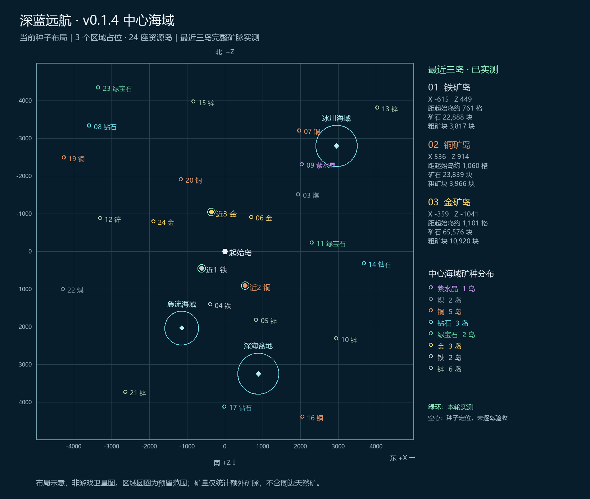
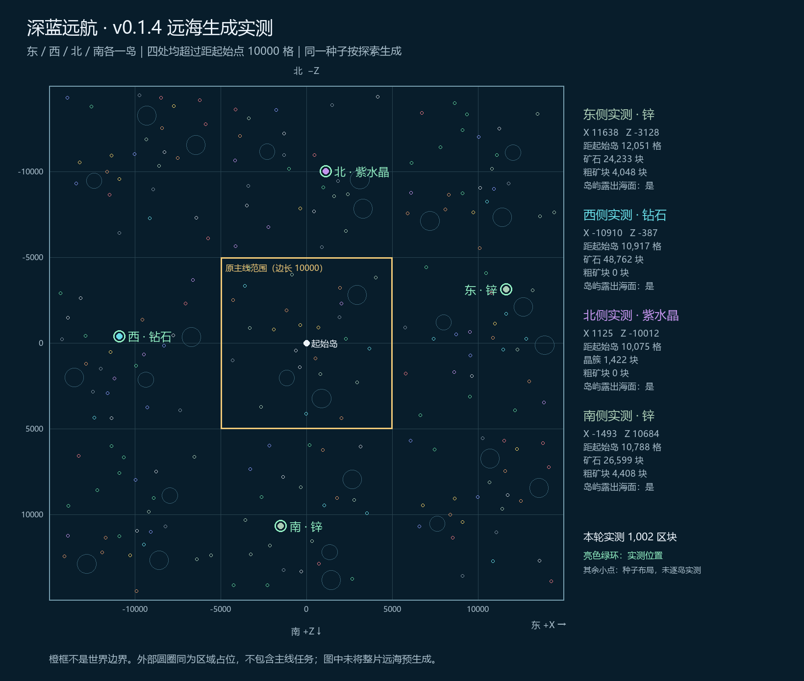

# v0.1.4 地图实测（2026-10-20）

实际启动当前整合包，读取联合开发交付存档的独立副本，按需生成并检查 1002 个区块。测试副本不回写用户正在使用的世界。

世界种子：`7667568505341616740`。

## 最近三岛与远海样本

| 地点 | 矿种 | X / Z | 距起点（格） | 矿石/成熟晶簇（块） | 粗矿块（块） |
|---|---|---|---:|---:|---:|
| 最近第1岛 | 铁 | -615 / 449 | 761 | 22,888 | 3,817 |
| 最近第2岛 | 铜 | 536 / 914 | 1,060 | 23,839 | 3,966 |
| 最近第3岛 | 金 | -359 / -1041 | 1,101 | 65,576 | 10,920 |
| 东侧远海 | 锌 | 11638 / -3128 | 12,051 | 24,233 | 4,048 |
| 西侧远海 | 钻石 | -10910 / -387 | 10,917 | 48,762 | 0 |
| 北侧远海 | 紫水晶簇 | 1125 / -10012 | 10,075 | 1,422 | 0 |
| 南侧远海 | 锌 | -1493 / 10684 | 10,788 | 26,599 | 4,408 |

最近三岛按岛中心到 (0,0) 的水平直线距离排序，满足铁、铜、金。四个远海样本不仅超出原边长10000格正方形（±5000），各自距离起点也超过10000格。7个样本均有出水岛体与可采集矿物。

统计范围为每岛额外矿脉的完整椭球形状，粗矿块单独计数；不把方块数等同于挖掘掉落数量。北侧统计的是成熟紫水晶簇。此结果不表示逐一验证了地图上的全部岛屿。

## 地图

两图是种子布局示意，非游戏卫星图。绿环标出本轮实测，空心小点为生成器算出的其他地点；圆圈仅为区域占位范围。此次没有预生成整个中心海域或整个远海。
